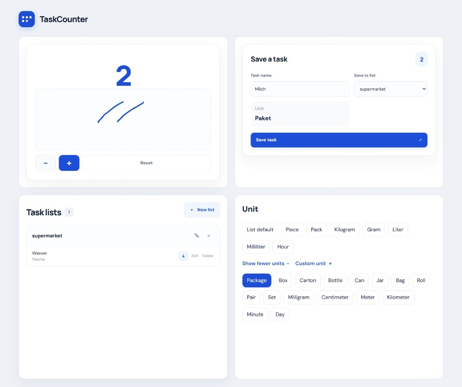

<div align="center">

# TaskCounter

**Turn small actions into visible progress.**

A task-counting and list-management app with an interactive counter, customizable units, and a responsive dashboard.


</div>

---

## English

### Overview

TaskCounter helps turn repeated actions and small tasks into measurable progress. Count with the interactive canvas or the counter buttons, then save the result to a task in one of your lists.

The application uses a **Vue 3 + Vite frontend** and a **Django REST Framework backend**. Task and list data is stored in a local SQLite database.



### Features

- **Interactive counter:** increase or decrease the count, reset it, or draw tally marks on the canvas.
- **Four-panel dashboard:** counter and task composer in the first row, task lists and unit selection in the second row.
- **Task lists:** create, rename, and delete lists with a confirmation modal.
- **Task management:** save, edit, and delete tasks; each task retains its count.
- **Flexible units:** pick from common units, reveal the full unit list, or enter a custom unit. Units are shown with saved tasks.
- **List defaults:** tasks can inherit the unit configured for their list, or use a unit specific to the task.
- **Overview statistics:** see the number of lists, saved tasks, and total counts.
- **Responsive interface:** the dashboard adapts to narrower screens, and typography scales fluidly with the viewport.
- **API-backed persistence:** list and task data is stored by the Django backend in SQLite.
- **Feedback and validation:** loading states, success/error messages, and form validation help make actions clear.

### Tech stack

| Area | Technology |
|---|---|
| Frontend | Vue 3, JavaScript, Vite |
| Styling | CSS, responsive layouts, fluid typography with `clamp()` |
| Backend | Python, Django, Django REST Framework |
| Database | SQLite |

### Project structure

```text
TaskCounter/
├── backend/
│   ├── manage.py
│   └── tasks/
└── frontend/
    ├── src/
    │   ├── components/
    │   ├── composables/
    │   ├── constants/
    │   └── services/
    └── package.json
```

### Getting started

You need Python, Node.js, and npm installed.

#### 1. Start the backend

Open a terminal in the backend directory:

```powershell
cd backend
python -m pip install -r requirements.txt
python manage.py migrate
python manage.py runserver
```

The backend runs at `http://127.0.0.1:8001/` by default, and the API base URL is `http://127.0.0.1:8001/api/`. To use a different port for one run, pass it explicitly, for example `python manage.py runserver 8010`.

> If the backend does not contain a `requirements.txt` file, install the project's Python dependencies using the dependency instructions in the repository before running the migration and server commands.

#### 2. Start the frontend

Open a second terminal in the frontend directory:

```powershell
cd frontend
npm install
npm run dev
```

Open `http://127.0.0.1:5174/`. TaskCounter uses a fixed frontend port; if it is already in use, Vite exits with an error instead of silently switching to another port. Choose a different, project-specific port in `frontend/vite.config.js` if needed.

### Units

The unit selector shows commonly used units first. Choose **Show all units** to reveal the remaining options, or select **Custom unit** to type your own. When **List default** is selected, the task uses the default unit of its selected list.

### Development status

TaskCounter is actively being developed. The interface and feature set may change as the project evolves.

---

## Deutsch

### Überblick

TaskCounter hilft dabei, wiederkehrende Tätigkeiten und kleine Aufgaben messbar zu machen. Du kannst Zählstriche auf einer interaktiven Zeichenfläche setzen oder die Zähler-Schaltflächen verwenden und das Ergebnis anschließend als Aufgabe in einer Liste speichern.

Die Anwendung besteht aus einem **Vue-3-Frontend mit Vite** und einem **Backend mit Django REST Framework**. Aufgaben und Listen werden lokal in einer SQLite-Datenbank gespeichert.

### Funktionen

- **Interaktiver Zähler:** Zähler erhöhen, verringern und zurücksetzen oder Zählstriche auf der Canvas-Zeichenfläche setzen.
- **Dashboard mit vier Boxen:** Zähler und Aufgabenformular oben, Aufgabenlisten und Einheiten-Auswahl darunter.
- **Listenverwaltung:** Listen erstellen, umbenennen und mit einer Bestätigung löschen.
- **Aufgabenverwaltung:** Aufgaben speichern, bearbeiten und löschen; der Zählerstand wird pro Aufgabe gespeichert.
- **Flexible Einheiten:** häufig verwendete Einheiten auswählen, die vollständige Liste einblenden oder eigene Einheiten eingeben. Die Einheiten werden bei gespeicherten Aufgaben angezeigt.
- **Standard-Einheit pro Liste:** Aufgaben können die Standard-Einheit ihrer Liste übernehmen oder eine eigene Einheit verwenden.
- **Übersichtsstatistiken:** Anzahl der Listen, gespeicherten Aufgaben und gesamten Zählerstände auf einen Blick.
- **Responsives Design:** Das Dashboard passt sich schmaleren Bildschirmen an. Schriftgrößen skalieren fließend mit der verfügbaren Bildschirmbreite.
- **Persistente Speicherung über die API:** Django speichert Listen und Aufgaben in SQLite.
- **Rückmeldungen und Validierung:** Ladezustände, Erfolgs- und Fehlermeldungen sowie Formularprüfungen.

### Technologien

| Bereich | Technologie |
|---|---|
| Frontend | Vue 3, JavaScript, Vite |
| Styling | CSS, responsives Layout, fließende Schriftgrößen mit `clamp()` |
| Backend | Python, Django, Django REST Framework |
| Datenbank | SQLite |

### Projektstruktur

```text
TaskCounter/
├── backend/
│   ├── manage.py
│   └── tasks/
└── frontend/
    ├── src/
    │   ├── components/
    │   ├── composables/
    │   ├── constants/
    │   └── services/
    └── package.json
```

### Lokal starten

Voraussetzungen: Python, Node.js und npm.

#### 1. Backend starten

Öffne ein Terminal im Backend-Verzeichnis:

```powershell
cd backend
python -m pip install -r requirements.txt
python manage.py migrate
python manage.py runserver
```

Das Backend läuft standardmäßig unter `http://127.0.0.1:8001/`. Die API-Basisadresse ist `http://127.0.0.1:8001/api/`. Für einen anderen Port kannst du ihn beim Start ausdrücklich angeben, zum Beispiel mit `python manage.py runserver 8010`.

> Falls keine `requirements.txt` vorhanden ist, installiere zuerst die Python-Abhängigkeiten entsprechend den Projektangaben.

#### 2. Frontend starten

Öffne ein zweites Terminal im Frontend-Verzeichnis:

```powershell
cd frontend
npm install
npm run dev
```

Öffne anschließend `http://127.0.0.1:5174/`. TaskCounter verwendet einen festen Frontend-Port. Ist dieser bereits belegt, beendet sich Vite mit einer Fehlermeldung, statt unbemerkt auf einen anderen Port auszuweichen. Falls nötig, kannst du in `frontend/vite.config.js` einen anderen, für dieses Projekt eindeutigen Port festlegen.

### Einheiten auswählen

In der Einheiten-Box werden zuerst die wichtigsten Einheiten angezeigt. Mit **Show all units** öffnest du die vollständige Liste. Über **Custom unit** kannst du eigene Einheiten eingeben. Bei **List default** verwendet eine Aufgabe die Standard-Einheit ihrer ausgewählten Liste.

### Entwicklungsstatus

TaskCounter wird laufend weiterentwickelt. Funktionen und Oberfläche können sich während der Entwicklung verändern.
